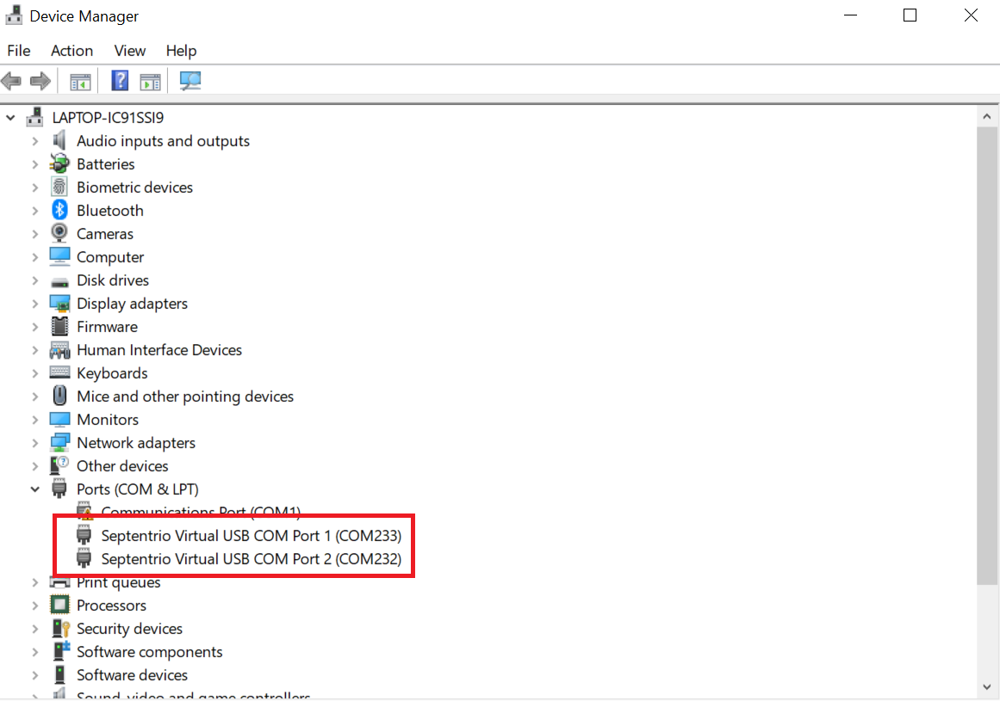
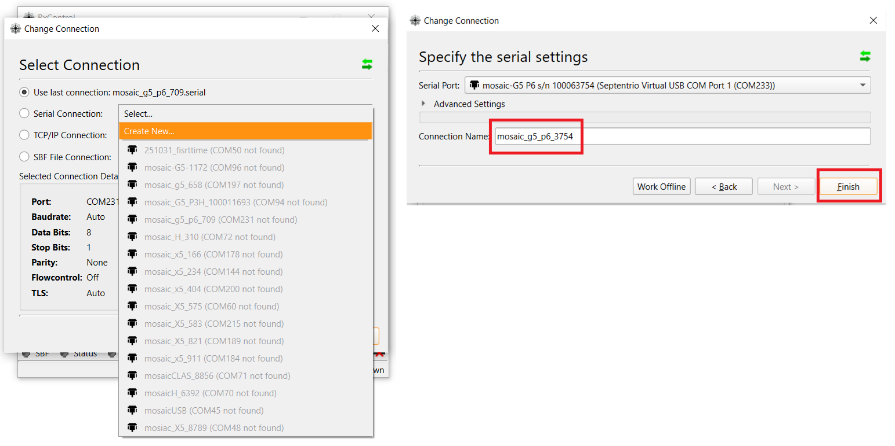
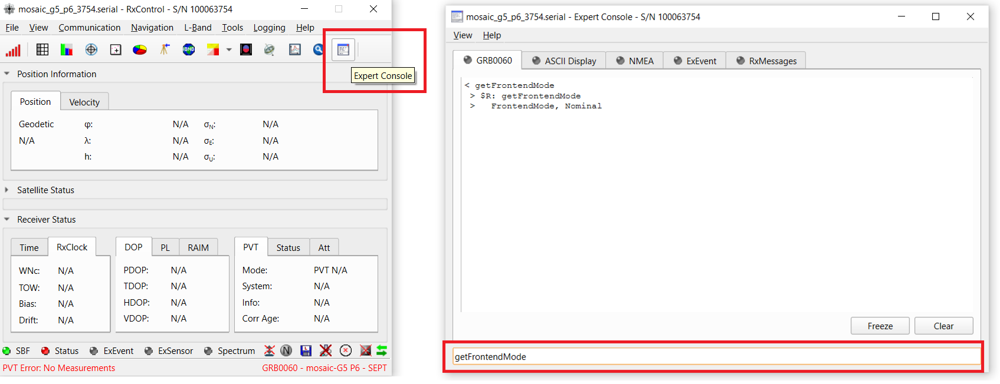
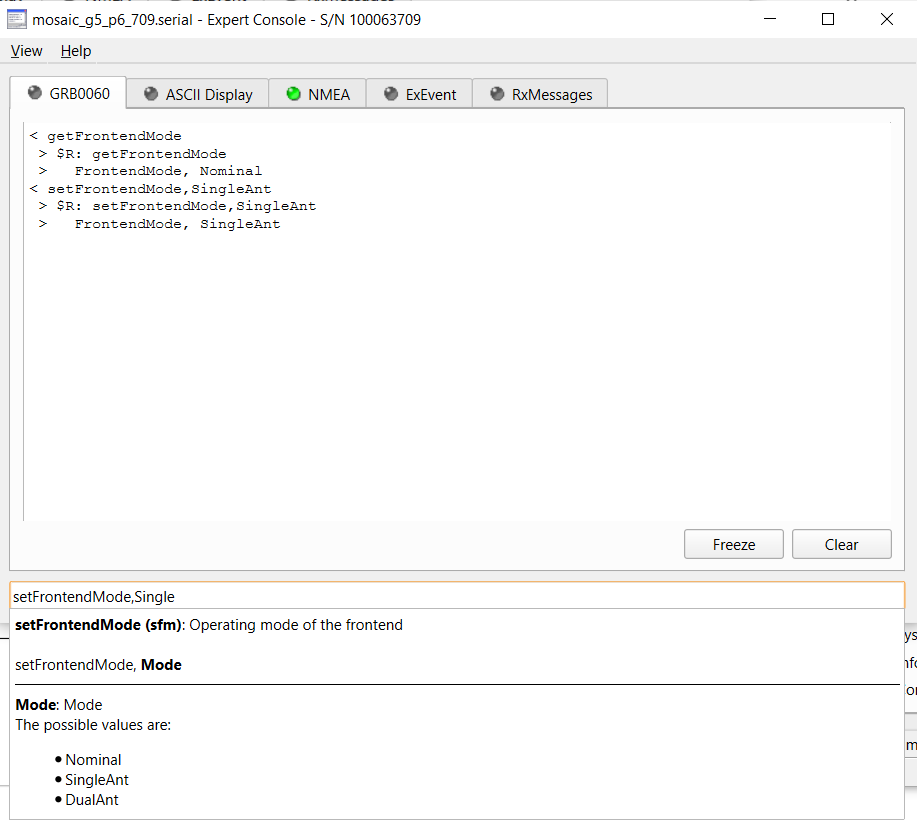
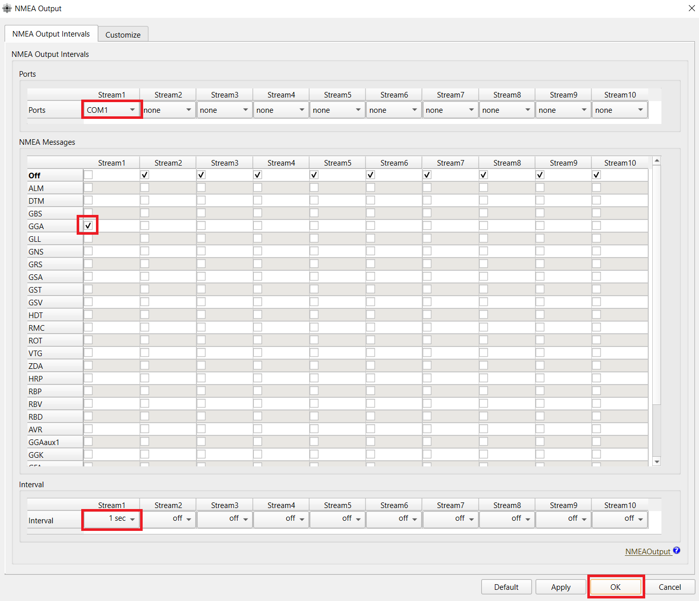
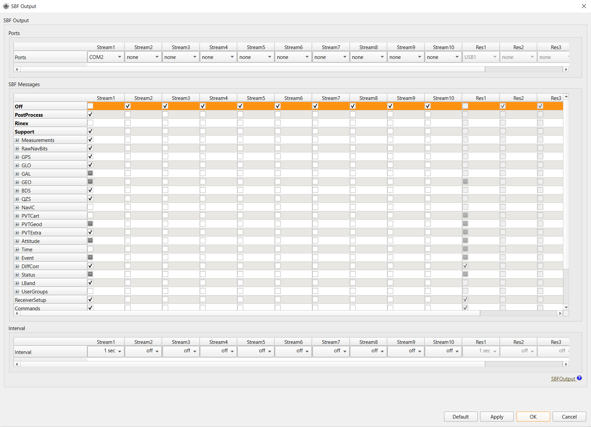
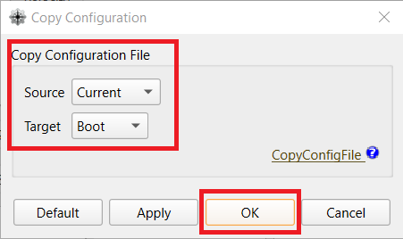

# Basic Setup
## First Connection with iChidori-Crest
### Overview
This guide walks through the initial connection of the **iChidori-Crest** to a Window PC, installing required software, and performing basic configuration of the mosaic-G5 receiver using **Septentrio RxControl**.

By the end of this test we will have:

- Connected the iChidori-Crest (mosaic G5 receiver) to RxControl
- Confirmed and set the antenna modes
- Enabled NMEA messages output on **COM1**
- Enabled SBF output on **COM2**
- Saved all settings as boot configuration

---

### Software Requirement
- **Septentrio USB Driver** — required for Windows to recognize the receiver. 
- **Septentrio RxTools** — Software suit to control and monitor your GNSS receiver

Download RxTools and User Manual: [https://www.septentrio.com/en/products/gps-gnss-receiver-software/rxtools](https://www.septentrio.com/en/products/gps-gnss-receiver-software/rxtools)
!!! note
    In the scope of these guides, we primarily use **RxControl** and **SBF Analyzer** for evaluation.

---

### Connect iChidori-Crest to PC
Connect the iChidori-Crest to your PC using a **USB Type-C cable**.

After plugging in, open **Device Manager** and verify the mosaic G5 receiver appers as two COM ports.

{ width=800" }

!!! warning
    If the COM ports do not appear in Device Manager or the connection fails, try reconnecting or replacing the USB-C cable.

---

### Connect RxControl to the mosaic G5 Receiver

Open **RxControl** application. On first launch with a new mosaic receiver, follow these steps to create a new connection:

1. Open **File → Change Connection**
2. Click **Serial Connection** → **Create New → Next**
3. At **Select Port**, choose the USB port shown in Device Manager — select **USB Port 1**
4. Enter a **Connection Name** — for example: `mosaic_g5_p6_3754`
5. Click **Finish**

The connection between RxControl and the mosaic-G5 receiver is now established.

{ width=850" }

---

### Confirm and Configure Antenna Mode

The mosaic G5 supports Single Antenna and Dual Antenna modes.

!!! info "Variant support"
    - **P1, P3**: Single Antenna only
    - **P3H, P6**: Single Antenna and Dual Antenna

To confirm the current antenna mode and setting new antenna mode, open the **Expert Console** by clicking its icon in the RxControl toolbar. Type the following commands and press **Enter**:

- `getFrontendMode` — query the current antenna mode
- `setFrontendMode, SingleAnt` — configure single-antenna mode at the next reboot
- `setFrontendMode, DualAnt` — configure dual-antenna (heading) mode at the next reboot
- `exeCopyConfigFile, Current, Boot` — save the configuration to the boot file
- `exeResetReceiver, Hard, none` — reboot to apply

{ width=850" }

{ width=850" }

---

### Enable - COM1, COM2 Output
Output NMEA GGA on COM1 - mosaic G5:

Open **Communication → Output Settings → NMEA Output**.  Configure on **Stream 1**:

| Field | Value |
|---|---|
| Port | COM1 |
| Message | GGA |
| Interval | 1 sec (1 Hz) |

{ width=850"}

---

Enable SBF Output on COM2 - mosaic G5:

Navigate to:
**Communication → Output Settings → SBF Output**. Configure on **Stream 1**:

| Field | Value |
|---|---|
| Port | COM2 |
| Blocks | PVTGeodetic, MeasEpoch,... |
| Interval | 1 sec (1 Hz) |

{ width=850"}

---

### Save Boot Configuration

After completing all settings, save the full configuration so it is restored after every power cycle.

To save the current configuration as boot configuration, open  **File->Copy Configuration**, and select Current as source, Boot as target. 
Click **Apply** and **OK** to save.

{ width=400" .center}

---
!!! warning
    Always save to Boot configuration after any change. Settings not saved to Boot will be lost after power cycle.

---

### Optional — Configure GPIO LEDs

The iChidori-Crest has two built-in LEDs connected to GPIO1 and GPIO2 of the mosaic-G5, useful for evaluation and field monitoring.

| GPIO | Function | Description |
|---|---|---|
| GPIO1 | `nRTKLED` | LED ON when RTK Fixed |
| GPIO2 | `nPVTLED` | LED ON when PVT solution available |

Open **Navigation → Receiver Operation -> GPIO**, set each GPIO to the corresponding function, then save to Boot configuration.

{ width=850"}

---

### Summary

In this artical, we completed the first connection of the iChidori-Crest to a PC using Septentrio RxControl. Starting from a fresh setup, we established a USB connection to the mosaic-G5 receiver, confirmed and setting the antenna operating mode, configured the receiver to output data on COM1 and COM2. All settings were saved to Boot configuration to ensure they persist across power cycles.

These output streams will be used for the next tests, where we explore RTK positioning and data logging on this GNSS receiver.

In the next artical, we will configure the iChidori-Crest as an **RTK Rover** using RxControl.

**Next:** [Configuring mosaic G5 as an RTK Rover →](rtk-rover.md)
