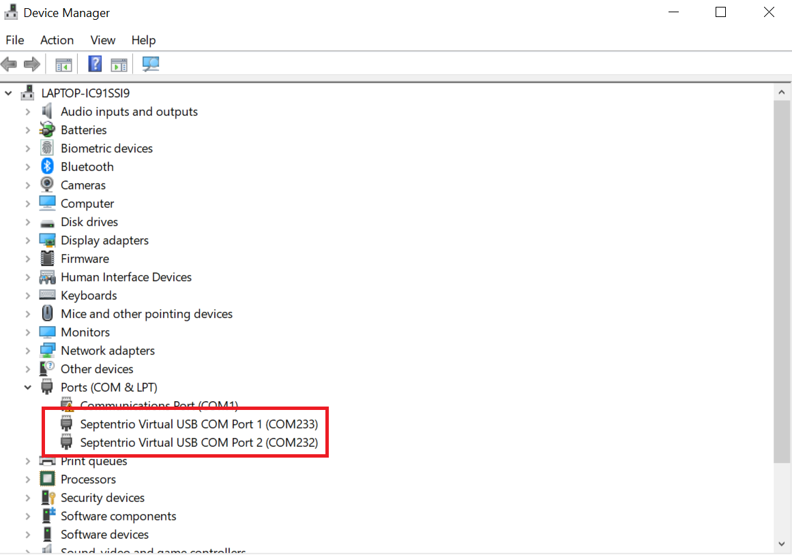
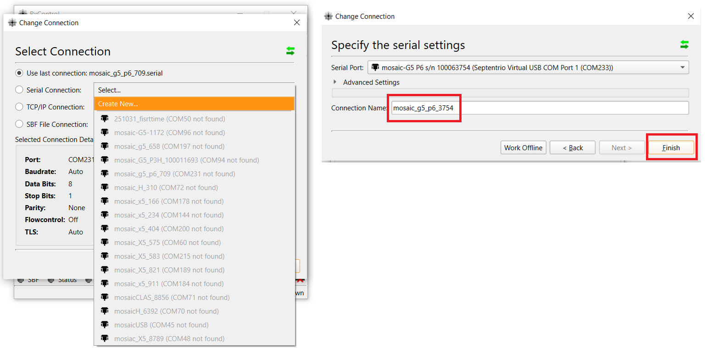
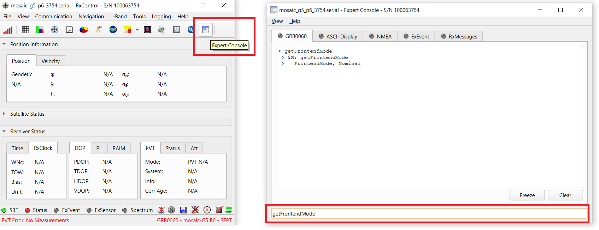
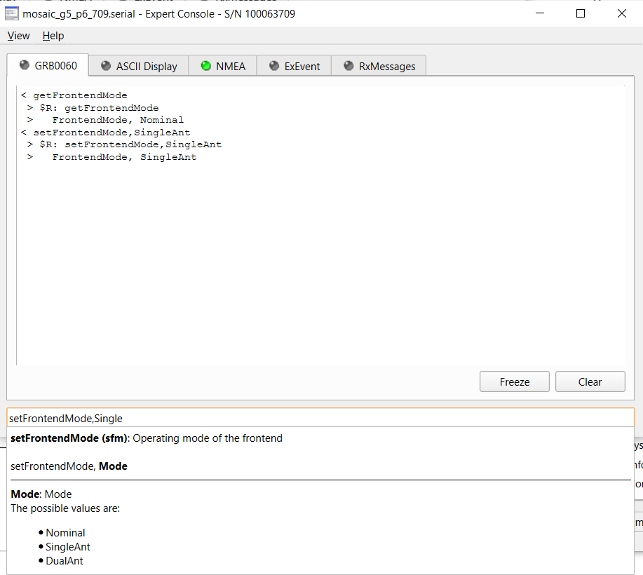
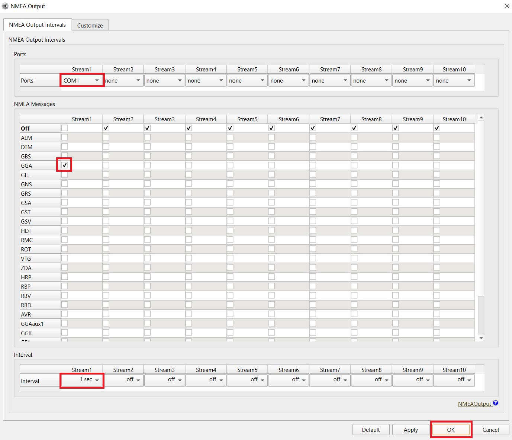
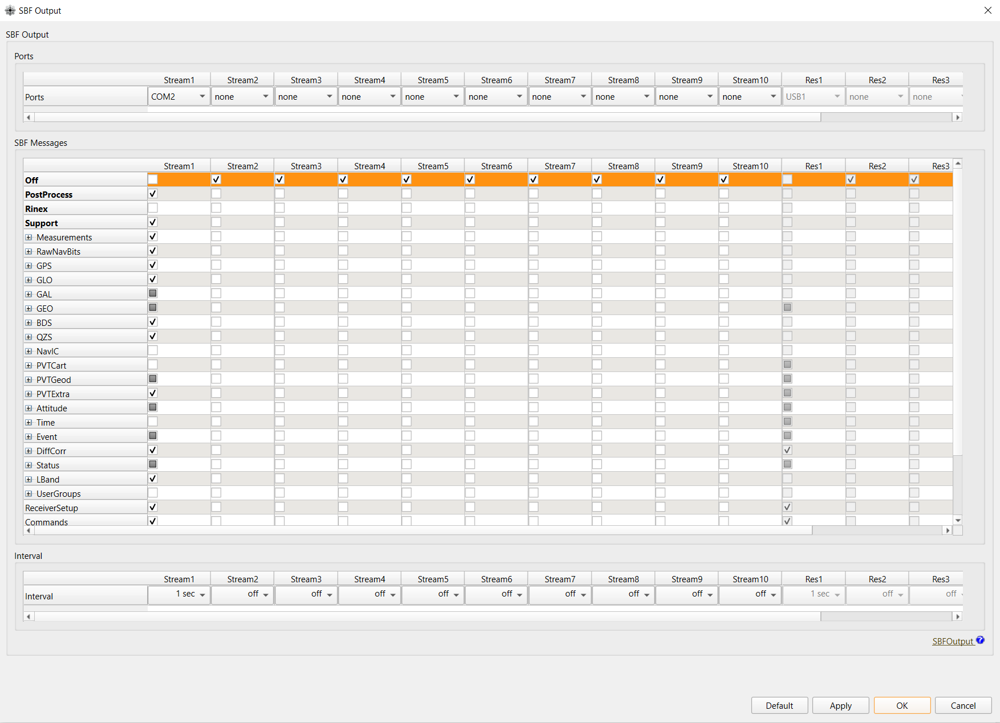
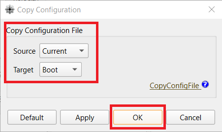
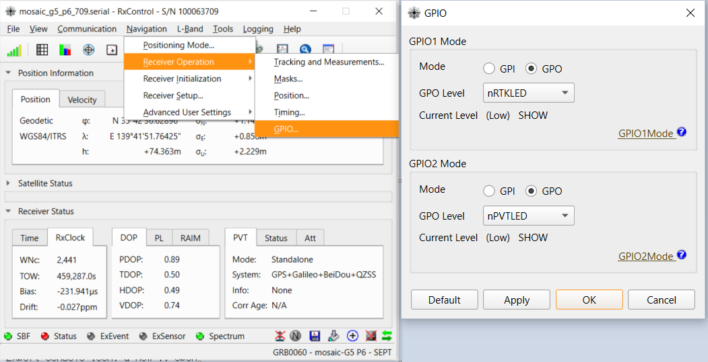

# Basic setup
## First connection with iChidori-Crest

### Overview

Before evaluating the mosaic-G5 receiver, a connection between the iChidori-Crest and a PC must be established. This guide covers the setup on Windows using Septentrio RxControl. This guide covers installing the required software, connecting to the receiver using Septentrio RxControl, and configuring the basic output settings needed for further evaluation.

By the end of this guide, the following will have been completed:

- Connected the iChidori-Crest to RxControl over USB
- Confirmed and set the antenna mode for the board variant
- Enabled NMEA output on COM1
- Enabled SBF output on COM2
- Saved all settings to the boot configuration

---

### Software requirements

The mosaic-G5 receiver requires a USB driver and the RxTools software suite to communicate with Windows.

- **Septentrio USB driver** — allows Windows to recognise the mosaic-G5 receiver as a serial device.
- **Septentrio RxTools** — a software suite for controlling and monitoring the GNSS receiver. This guide uses RxControl and SBF Analyzer from within the suite.

Download software from the official Septentrio page: [RxTools](https://www.septentrio.com/en/products/gps-gnss-receiver-software/rxtools)

---

### Connect the iChidori-Crest to the PC

Connect the iChidori-Crest to the Windows PC using a USB Type-C cable. Make sure to use a cable that supports data transfer, not a charge-only cable.

Once connected, open **Device Manager** and confirm that the mosaic-G5 serial ports appear in the list.

{ width="800" }

!!! warning "Connection troubleshooting"
    If the ports do not appear, check that the Septentrio USB driver is installed correctly. Try reconnecting the board or using a different USB Type-C cable.

---

### Connect RxControl to the receiver

With the USB ports detected, create a connection in RxControl. On first launch, the receiver will not yet have a saved connection profile, so a new one must be created.

1. Open the **RxControl** application.
2. Select **File → Change Connection**.
3. Select **Serial Connection → Create New → Next**.
4. Under **Select Port**, choose the receiver's USB port — in most setups, select **USB Port 1**.
5. Enter a connection name, for example: `mosaic_g5_p6_3754`.
6. Click **Finish** to save the connection.

RxControl will connect to the receiver and display its status.

{ width="850" }

---

### Confirm and configure the antenna mode

The mosaic-G5 supports both single-antenna and dual-antenna (heading) operation. The available modes depend on the iChidori-Crest variant in use.

!!! info "Variant support"
    - **P1, P3** — single-antenna only
    - **P3H, P6** — single-antenna or dual-antenna (heading)

To check and configure the antenna mode, open the **Expert Console** from the RxControl toolbar and enter the following commands one at a time.

- `getFrontendMode` — query the current antenna mode
- `setFrontendMode, SingleAnt` — set single-antenna mode (takes effect after reboot)
- `setFrontendMode, DualAnt` — set dual-antenna mode (takes effect after reboot)
- `exeCopyConfigFile, Current, Boot` — save the configuration to the boot file
- `exeResetReceiver, Hard, none` — reboot to apply

{ width="850" }

{ width="850" }

!!! warning
    The antenna mode does not take effect until the receiver restarts. If a mode change is required, save the configuration first, complete the remaining settings, then reboot.

---

### Enable NMEA output on COM1

NMEA output allows external devices — such as a Raspberry Pi or a display application — to receive position data from the receiver in a standard format.

Navigate to **Communication → Output Settings → NMEA Output** and configure Stream 1 as follows:

| Field    | Value        |
|----------|--------------|
| Port     | COM1         |
| Message  | GGA          |
| Interval | 1 sec (1 Hz) |

{ width="850" }

---

### Enable SBF output on COM2

SBF (Septentrio Binary Format) provides raw GNSS measurements and is used for post-processing and advanced analysis with SBF Analyzer.

Navigate to **Communication → Output Settings → SBF Output** and configure Stream 1 as follows:

| Field    | Value                       |
|----------|-----------------------------|
| Port     | COM2                        |
| Blocks   | PVTGeodetic, MeasEpoch, ... |
| Interval | 1 sec (1 Hz)                |

{ width="850" }

---

### Save the boot configuration

Settings in the mosaic-G5 are held in RAM and will be lost after a power cycle unless explicitly saved. After completing all configuration, save everything to the boot file so the receiver restores its state on every startup.

Go to **File → Copy Configuration**, set **Source** to *Current* and **Target** to *Boot*, then click **Apply** and **OK**.

{ width="400" .center }

!!! warning
    Always save to the boot configuration after making any change. Settings not saved to boot will be lost after a power cycle.

---

### Optional — Configure the GPIO LEDs

The iChidori-Crest provides two onboard LEDs connected to GPIO1 and GPIO2 of the mosaic-G5. Configuring these gives a quick visual indication of receiver status during evaluation and field testing.

| GPIO  | Function  | Behaviour                      |
|-------|-----------|--------------------------------|
| GPIO1 | `nRTKLED` | LED on when RTK fixed          |
| GPIO2 | `nPVTLED` | LED on when PVT solution valid |

Open **Navigation → Receiver Operation → GPIO**, assign each GPIO to its function, then save to boot configuration.

{ width="850" }

---

### Summary

This guide covered the first connection of the iChidori-Crest to a PC using RxControl. Starting from a fresh setup, a USB connection to the mosaic-G5 receiver was established, the antenna mode was confirmed, NMEA and SBF output streams were configured, and all settings were saved to the boot configuration to persist across power cycles.

These output streams will be used in the next guide, where the iChidori-Crest is configured as an RTK rover.

**Next:** [Configuring mosaic-G5 as an RTK rover →](rtk-rover.md)