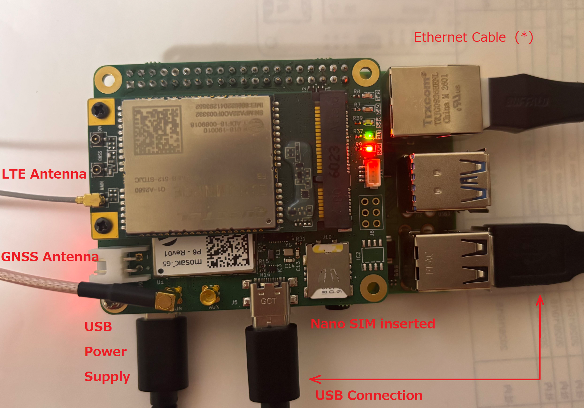
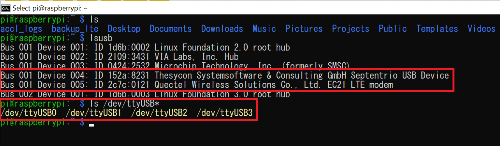
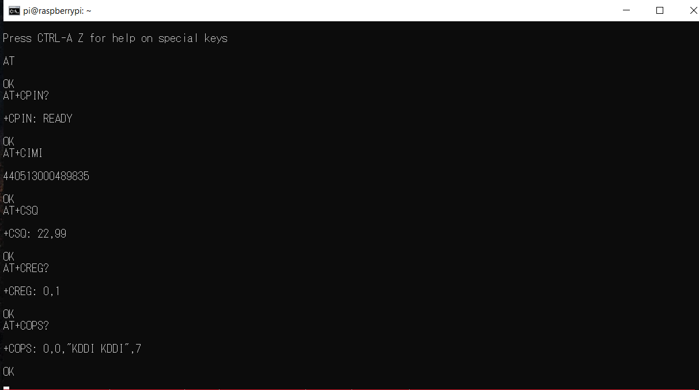
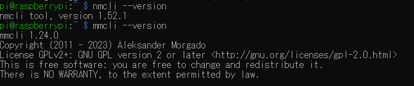
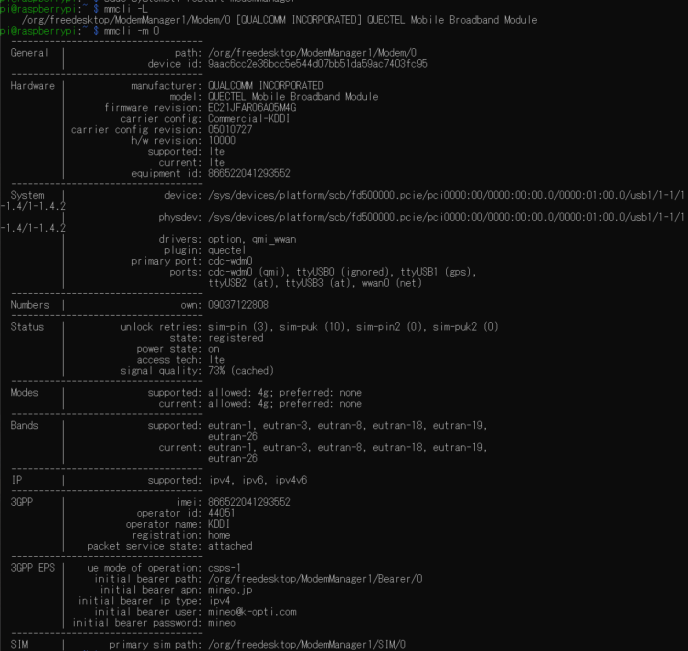
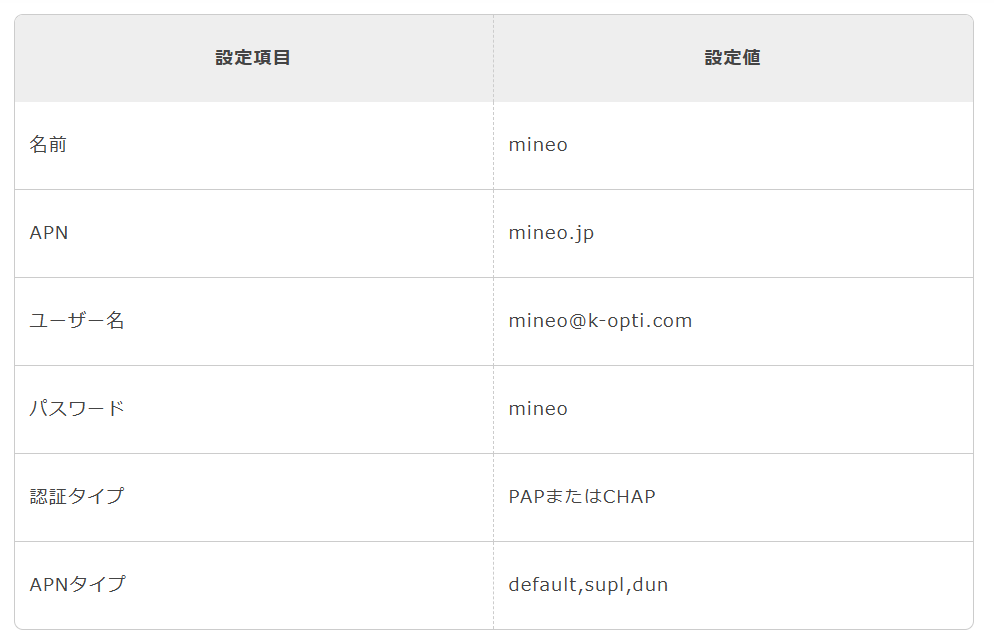
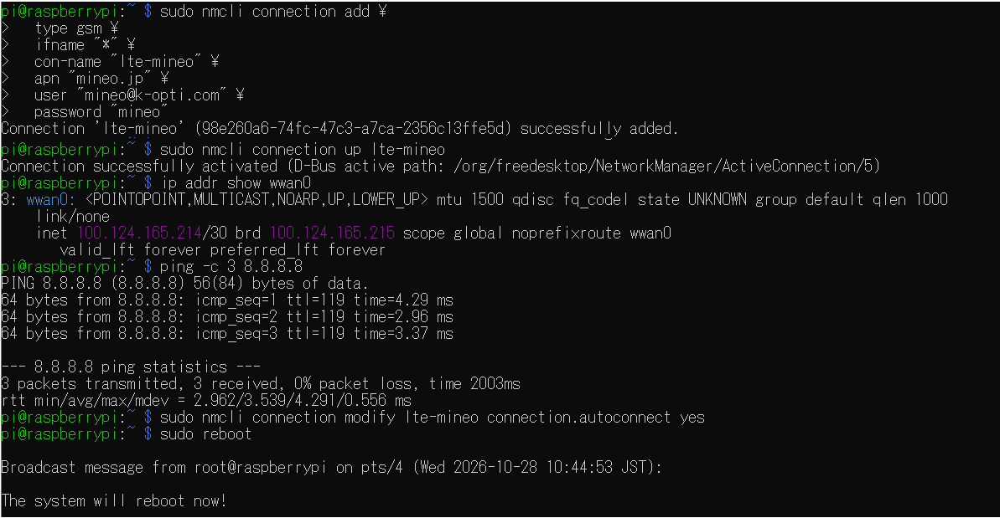

# LTE Connectivity with the iChidori-Crest

## Overview

The iChidori-Crest supports **LTE connectivity** through a cellular modem installed in its mPCIe slot. When combined with a Raspberry Pi, it provides Internet connectivity for the system.

The LTE configuration process depends on the modem being used, as setup procedures and carrier settings may vary between modem models.

This guide demonstrates a complete LTE setup using the [Quectel EC21-J modem](https://soracom.jp/store/5295/), from initial hardware detection and SIM configuration to automatic connection at startup.

The configuration follows the standard Linux networking stack:

- [ModemManager](https://modemmanager.org/docs/) detects and manages the cellular modem, including SIM status and mobile network registration.
- [NetworkManager](https://networkmanager.dev/docs/admins/) configures and manages the LTE connection profile and network interface.

## Hardware Requirements

- Raspberry Pi 4 with the iChidori-Crest installed.
- Raspberry Pi OS.
- Quectel EC21-J installed in the mPCIe slot.
- Active nano-SIM card inserted into the iChidori-Crest SIM slot.
- LTE antenna connected to the modem's antenna port.
- Suitable 5 V power supply for the Raspberry Pi.
- A USB Type-C cable connecting the Raspberry Pi to the iChidori-Crest's USB port.

A valid SIM subscription, compatible carrier settings, and sufficient cellular coverage are required for Internet access.

!!! note "Example Configuration"
    This guide uses the Quectel EC21-J with a mineo SIM operating on the au (KDDI) network. The APN and authentication settings may differ depending on the SIM provider and must be configured accordingly.

## Hardware Setup

{ width="800" }

!!! note
    The LAN cable is used only to access the Raspberry Pi via SSH during the initial setup and configuration. It is not required for LTE connectivity.

## 1. Verify LTE Modem Detection

After powering on the Raspberry Pi with the LTE modem installed on the iChidori-Crest, verify that the modem is detected over USB.

### Check USB Detection

Execute the following commands:

```bash
lsusb
ls /dev/ttyUSB* 2>/dev/null
```

Example output:

{ width="800" }

The device ID and bus information may differ depending on the hardware and USB configuration.

!!! note "Quectel EC21-J USB Serial Interfaces"
    The EC21-J exposes four USB serial interfaces. Each serves a specific purpose:

    | Interface | Function | Description |
    |---|---|---|
    | `/dev/ttyUSB0` | Modem / diagnostics | General modem control and diagnostic functions. |
    | `/dev/ttyUSB1` | GNSS NMEA output | GNSS data output, if supported and enabled in the modem configuration. |
    | `/dev/ttyUSB2` | AT commands | Primary interface for sending AT commands. |
    | `/dev/ttyUSB3` | AT commands | Secondary AT command interface. |

    The interface mapping above is based on the tested EC21-J configuration. Actual assignments may vary depending on modem firmware and USB configuration. Verify the available interfaces on the target device before use.

!!! note "GNSS and LTE USB Interfaces"
    The Septentrio mosaic-G5 GNSS module typically appears as `/dev/ttyACM0` and `/dev/ttyACM1`, while the Quectel LTE modem uses `/dev/ttyUSBx` interfaces.

    These device names identify different hardware interfaces and should not be confused.

## 2. Verify Modem Communication and SIM Status

This step verifies communication with the Quectel EC21-J modem, checks the SIM card and mobile network status, and prepares the modem for LTE connection configuration.

### Install an AT Command Terminal

AT commands can be sent to the LTE modem through its AT command interface using a serial terminal or other serial communication tools.

This guide uses `minicom` as an example. Install it if it is not already available:

```bash
sudo apt update
sudo apt install minicom -y
```

!!! note "AT Command Terminal Options"
    This guide uses `minicom`, but any serial terminal tool works. Common alternatives include `screen` and `tio`. The choice depends on personal preference.

Next, open the EC21-J AT command interface:

```bash
sudo minicom -D /dev/ttyUSB2 -b 115200
```

The example uses `/dev/ttyUSB2` as the AT command interface. Confirm the port assignment according to the USB serial interface mapping described in Step 1.

If the characters you type are not displayed, enable local echo by pressing `Ctrl+A`, followed by `E`.

### Verify Modem and SIM Status

Enter the following AT commands to confirm that the modem and SIM are ready:

| AT Command | Purpose | Expected Response |
|---|---|---|
| `AT` | Verify communication | `OK` |
| `AT+CPIN?` | Check SIM card status | `+CPIN: READY` |
| `AT+CIMI` | Read SIM IMSI | Numeric IMSI value |
| `AT+CSQ` | Check signal strength | `+CSQ: <rssi>,<ber>` |

### Verify Network Registration

Execute the following commands:

```text
AT+CEREG?
AT+COPS?
```

| AT Command | Purpose |
|---|---|
| `AT+CEREG?` | Check LTE/EPS network registration status. |
| `AT+COPS?` | Check the selected mobile network operator. |

A response containing `+CEREG: 0,1` confirms that the modem is registered on its home network.

Example output:

{ width="800" }

!!! warning "Network Registration"
    If the modem is not registered, verify SIM activation, antenna connection, signal strength, and carrier coverage before proceeding.

After verifying modem and SIM status, exit Minicom. The APN settings will be configured in the next step through NetworkManager.

## 3. Install and Configure ModemManager

**ModemManager** handles modem detection and coordinates with **NetworkManager** to manage the LTE connection.

### Install ModemManager

Install ModemManager if it is not already available:

```bash
sudo apt update
sudo apt install modemmanager -y
```

Verify that both tools are available:

```bash
nmcli --version
mmcli --version
```

Raspberry Pi OS includes NetworkManager by default, so no additional installation is required.

Example output:

{ width="800" }

### Verify ModemManager Detects the Modem

Run the following command to check whether ModemManager detects the LTE modem:

```bash
mmcli -L
```

Expected output:

```text
/org/freedesktop/ModemManager1/Modem/0 [QUALCOMM INCORPORATED] QUECTEL Mobile Broadband Module
```

!!! warning "Troubleshooting: No modems were found"

    During testing, `mmcli -L` returned `No modems were found`, even though the EC21-J was installed and powered.

    **1. Verify USB device detection**

    First, check whether the Raspberry Pi recognizes the modem over USB:

    ```bash
    lsusb | grep -i quectel
    ```

    Example output:

    ```text
    Bus 001 Device 005: ID 2c7c:0121 Quectel Wireless Solutions Co., Ltd. EC21 LTE modem
    ```

    This confirms that the Linux kernel recognizes the EC21-J as a USB device. However, USB detection alone does not guarantee that ModemManager can manage the modem.

    **2. Inspect udev properties**

    Check the udev properties of the modem's serial interface:

    ```bash
    udevadm info /dev/ttyUSB2 | grep -i "ID_VENDOR\|ID_MODEL\|ID_MM"
    ```

    During testing, the following properties were observed:

    ```text
    E: ID_MODEL=Android
    E: ID_MODEL_ID=0121
    E: ID_VENDOR=Android
    E: ID_VENDOR_ID=2c7c
    E: ID_VENDOR_FROM_DATABASE=Quectel Wireless Solutions Co., Ltd.
    E: ID_MODEL_FROM_DATABASE=EC21 LTE modem
    ```

    The EC21-J KDDI firmware reports `Android` as its USB vendor and product descriptor strings, while its USB vendor and product IDs identify the device as Quectel EC21 (`2c7c:0121`).

    In this configuration, the device was not tagged as a ModemManager candidate (`ID_MM_CANDIDATE=1`). This prevented ModemManager from detecting the modem.

    **3. Apply a custom udev rule**

    Create a udev rule to identify the EC21-J using its USB vendor and product IDs instead of the descriptor strings:

    ```bash
    echo 'ATTRS{idVendor}=="2c7c", ATTRS{idProduct}=="0121", ENV{ID_MM_CANDIDATE}="1"' \
      | sudo tee /etc/udev/rules.d/99-quectel-ec21.rules
    ```

    Reload the udev rules and restart ModemManager:

    ```bash
    sudo udevadm control --reload-rules
    sudo udevadm trigger
    sudo systemctl restart ModemManager
    sleep 5
    ```

    **4. Verify modem detection**

    Run the detection command again:

    ```bash
    mmcli -L
    ```

    Expected output:

    ```text
    /org/freedesktop/ModemManager1/Modem/0 [QUALCOMM INCORPORATED] QUECTEL Mobile Broadband Module
    ```

    The EC21-J should now be detected by ModemManager.

    **Note:** This workaround was verified with the EC21-J KDDI firmware variant. Other EC21 firmware versions or modem models may not require this additional udev rule.

After successful detection, retrieve the modem details to check its status and available interfaces:

```bash
mmcli -m 0
```

Example output:

{ width="800" }

## 4. Create the LTE Connection Profile

{ width="800" }

Create a connection profile with the APN credentials. This example uses **mineo on the au (KDDI) network**:

```bash
sudo nmcli connection add \
  type gsm \
  ifname "*" \
  con-name "lte-mineo" \
  apn "mineo.jp" \
  user "mineo@k-opti.com" \
  password "mineo"
```

Expected output:

```text
Connection 'lte-mineo' (...) successfully added.
```

!!! note "APN Settings"
    The `apn`, `user`, and `password` values must match the SIM provider's configuration. Contact the carrier or refer to its documentation for the correct APN and authentication settings.

## 5. Activate and Verify LTE Connectivity

### Activate the Connection

Activate the LTE connection profile:

```bash
sudo nmcli connection up lte-mineo
```

Expected output:

```text
Connection successfully activated (D-Bus active path: /org/freedesktop/NetworkManager/ActiveConnection/5)
```

### Verify the Network Interface

Check the LTE network interface:

```bash
ip addr show wwan0
```

The `wwan0` interface should have an assigned IP address.

Example output:

```text
3: wwan0: <POINTOPOINT,MULTICAST,NOARP,UP,LOWER_UP> mtu 1500 ...
    inet 100.124.165.x/30 brd 100.124.165.x scope global noprefixroute wwan0
```

The assigned IP address may differ depending on the carrier and network configuration.

### Test Internet Connectivity

First, test IP connectivity:

```bash
ping -c 3 8.8.8.8
```

Example output:

```text
64 bytes from 8.8.8.8: icmp_seq=1 ttl=119 time=4.29 ms
64 bytes from 8.8.8.8: icmp_seq=2 ttl=119 time=2.96 ms
64 bytes from 8.8.8.8: icmp_seq=3 ttl=119 time=3.37 ms
```

Next, verify DNS resolution:

```bash
getent hosts google.com
```

A successful response indicates that the hostname can be resolved.

!!! success "LTE Connection Established"
    If the LTE interface is up, an IP address is assigned, and the connectivity tests succeed, the Raspberry Pi is connected to the Internet over LTE.

## 6. Configure Automatic Connection at Startup

NetworkManager supports automatic connection activation through its connection profile settings.

Enable autoconnect for the LTE connection:

```bash
sudo nmcli connection modify lte-mineo connection.autoconnect yes
```

Verify the setting:

```bash
nmcli connection show lte-mineo | grep autoconnect
```

Expected output:

```text
connection.autoconnect:                 yes
```

NetworkManager automatically attempts to activate the connection profile at startup and reconnects when possible if the connection is interrupted. No additional systemd service configuration is required.

Example output:

{ width="800" }

## Summary

This guide demonstrated how to configure LTE connectivity on the iChidori-Crest using the Quectel EC21-J modem and a mineo SIM on the au (KDDI) network.

Once configured, the Raspberry Pi can access the Internet through the LTE network without requiring a wired LAN connection.

The same configuration approach can be adapted for other supported LTE modems and SIM providers by adjusting the modem-specific settings and APN credentials.