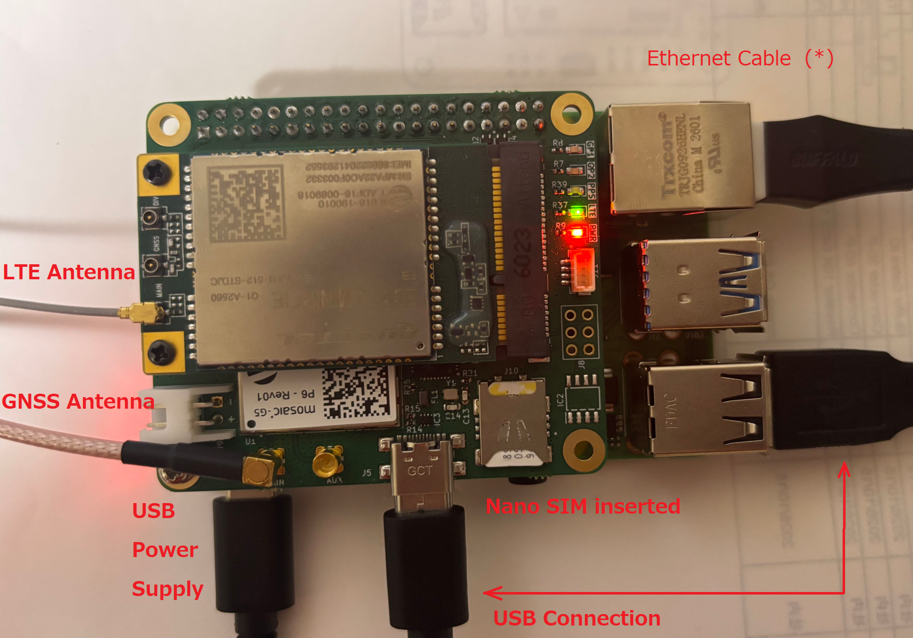
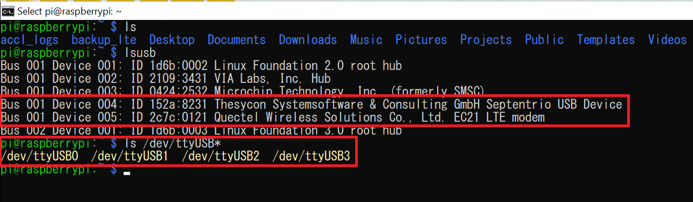
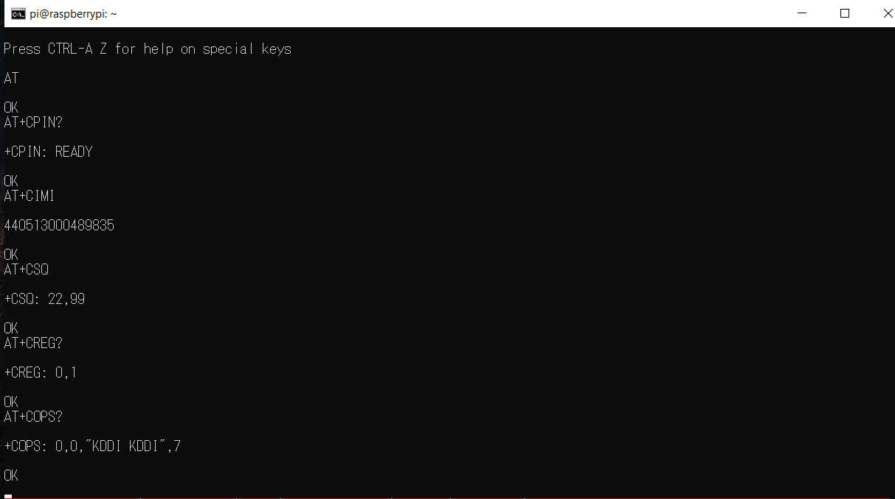
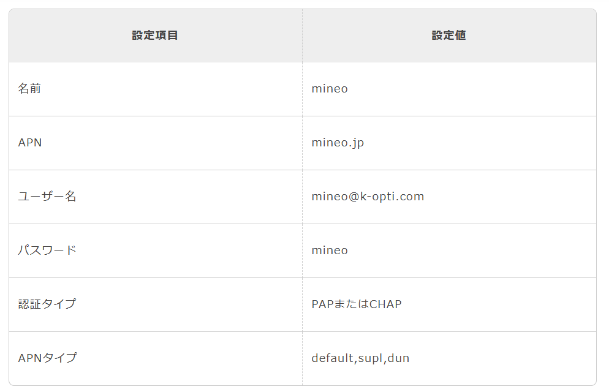

# LTE Connectivity with the iChidori-Crest

## Overview

This guide describes how to establish an LTE mobile data connection using the **iChidori-Crest, Raspberry Pi, and Quectel EC21-J LTE modem**.

The iChidori-Crest features an mPCIe slot for compatible LTE modem modules and an onboard nano-SIM slot. In this example, the Quectel EC21-J (LTE Cat 1) is used to establish a mobile data connection through **Point-to-Point Protocol (PPP)**.

The procedure covers:

- Verifying that the LTE modem is detected by the Raspberry Pi.
- Communicating with the modem using AT commands.
- Configuring the APN for the SIM card provider.
- Establishing an LTE data connection using PPP.
- Configuring the connection to start automatically at boot.

---

## Setup Requirement

The following hardware and software are required:

- Raspberry Pi 4 with the iChidori-Crest attached.
- Raspberry Pi OS with access through SSH or a local terminal.
- Quectel EC21-J LTE modem installed in the mPCIe slot.
- An active nano-SIM card with an LTE data plan, inserted into the iChidori-Crest's SIM slot.
- A 5 V power supply for the Raspberry Pi 4.
- A USB-C cable to connect the Raspberry Pi to the iChidori-Crest's USB port.

---
## Hardware Setup

{ width="800" }

---

## Step 1 — Verify LTE Modem Detection

After powering on the Raspberry Pi with the LTE modem installed on iChidori-Crest, verify that the LTE modem is detected over USB.

### Check USB Devices

Execute the following commands:

```bash
$ lsusb
```

```bash
$ ls /dev/ttyUSB*
```

Example output:

{ width="800" }

The device ID and bus information may differ depending on the hardware and USB configuration.

!!! note "Quectel EC21-J USB Serial Interfaces"

    The Quectel EC21-J typically exposes four USB serial interfaces (`/dev/ttyUSB0` to `/dev/ttyUSB3`). Each interface serves a specific purpose.

    | Serial Port | Typical Function | Description |
    |---|---|---|
    | `/dev/ttyUSB0` | Modem management | General modem control and diagnostic functions. |
    | `/dev/ttyUSB1` | GNSS NMEA output | GNSS data interface, if supported and enabled in the modem configuration. |
    | `/dev/ttyUSB2` | AT command interface | Used to send AT commands for modem configuration, SIM status, signal strength, and network registration. |
    | `/dev/ttyUSB3` | PPP data connection | Commonly used for establishing a PPP connection, depending on the modem firmware and USB configuration. |

    The interface assignments shown above are typical examples and may vary depending on the modem firmware and configuration. Verify the available interfaces and their functions on the target device before use.

!!! note "GNSS and LTE USB Interfaces"
    The Septentrio mosaic-G5 GNSS module typically appears as `/dev/ttyACM0` and `/dev/ttyACM1`, while the Quectel LTE modem uses `/dev/ttyUSBx` interfaces.

    These device names identify different hardware interfaces and should not be confused.

---

## Step 2 — Verify Modem Communication and Configure the APN

This step verifies communication with the Quectel EC21-J modem, checks the SIM card and mobile network status, and configures the Access Point Name (APN) for the LTE connection.

### Install an AT Command Terminal

AT commands can be sent to the LTE modem through its AT command interface using a serial terminal or other serial communication tools.

This guide uses `minicom` as an example because it provides an interactive terminal for sending AT commands and viewing modem responses. Other tools can be used if preferred.

To install `minicom`:

```bash
sudo apt update
sudo apt install minicom -y
```

### Open the AT Command Interface

Connect to the modem's AT command port:

```bash
sudo minicom -D /dev/ttyUSB2 -b 115200
```

The example uses `/dev/ttyUSB2` as the AT command interface. Confirm the port assignment according to the USB serial interface mapping described in Step 1.

If necessary, enable local echo by pressing `Ctrl+A`, followed by `E`, so that typed characters are displayed in the terminal.

### Verify Modem and SIM Status

Enter the following AT commands for verify LTE EC21-J modem status.

| AT Command | Purpose | Expected Response |
|---|---|---|
| `AT` | Verify communication with the modem | `OK` |
| `AT+CPIN?` | Check SIM card status | `+CPIN: READY` |
| `AT+CIMI` | Read the SIM's IMSI | Numeric IMSI value |
| `AT+CSQ` | Check signal strength | `+CSQ: <rssi>,<ber>` |

### Verify Network Registration

Check the mobile network registration status:

```text
AT+CREG?
AT+CEREG?
AT+COPS?
```

The commands provide the following information:

| AT Command | Purpose |
|---|---|
| `AT+CREG?` | Check circuit-switched network registration status |
| `AT+CEREG?` | Check LTE/EPS network registration status |
| `AT+COPS?` | Identify the selected mobile network operator |

Example response:

{ width="800" }


!!! warning "Network Registration"
    If the modem is not registered, verify SIM activation, antenna connection, signal strength, carrier coverage, and the SIM's network access settings before proceeding.

### Configure the APN

The Access Point Name (APN) identifies the packet data network used by the mobile carrier.

This example uses the APN settings for **mineo on the au network**. The APN and authentication parameters must match the SIM card provider's configuration.

{ width="600" .center}

Before configuring the APN, detach from the network to allow changes to the PDP context:

```text
AT+CGATT=0
```

Response: `OK`

Set the PDP context with the carrier APN:

```text
AT+CGDCONT=1,"IP","mineo.jp"
```

Response: `OK`

Set the APN with authentication credentials (CHAP):

```text
AT+QICSGP=1,1,"mineo.jp","mineo@k-opti.com","mineo",2
```

Response: `OK`

Verify the PDP context configuration:

```text
AT+CGDCONT?
```

Response:

```text
+CGDCONT: 1,"IP","mineo.jp","0.0.0.0",0,0,0,0
```

Re-attach to the network:

```text
AT+CGATT=1
```

Expected response: `OK`

Verify network registration:

```text
AT+CREG?
```

Response:

```text
+CREG: 0,1
```

A registration status of `1` confirms that the modem is registered on the home network.

After completing the modem checks and APN configuration, exit Minicom.

---

## Step 4 — Establish a PPP Data Connection

PPP allows the Raspberry Pi to exchange IP traffic with the LTE modem over a serial interface. When the connection is established successfully, the Raspberry Pi creates a network interface named `ppp0`.

### Install and Verify PPP

Check whether `pppd` is installed:

```bash
pppd --version
```

If the command is unavailable, install the PPP package:

```bash
sudo apt update
sudo apt install ppp -y
```

### Create the PPP Peer Configuration

Create a peer configuration file:

```bash
sudo nano /etc/ppp/peers/mineo-ec21-usb
```

Add the following configuration:

```text
/dev/ttyUSB3
115200
connect "/usr/sbin/chat -v -f /etc/chatscripts/mineo-ec21"
noauth
defaultroute
usepeerdns
noipdefault
novj
novjccomp
noccp
ipcp-accept-local
ipcp-accept-remote
lock
noipv6
lcp-echo-interval 0
```

Save the file and exit the editor.

### Create the Chat Script

Create the chat script used to initialize the modem before starting PPP:

```bash
sudo nano /etc/chatscripts/mineo-ec21
```

Add the following content:

```text
ABORT "BUSY"
ABORT "NO CARRIER"
ABORT "ERROR"
TIMEOUT 30
"" AT
OK ATH
OK ATE0
OK AT+CGDCONT=1,"IP","mineo.jp"
OK ATD*99#
CONNECT ""
```

Save the file and exit.

The chat script sends AT commands to initialize the modem, configure the APN, and request a data connection. Once the modem returns `CONNECT`, PPP negotiation begins.

!!! info "Configuration File Reference"

    **`/etc/ppp/peers/mineo-ec21-usb`**

    | Parameter | Description |
    |---|---|
    | `/dev/ttyUSB3` | Serial interface used for the PPP data connection |
    | `115200` | Serial communication speed |
    | `connect` | Runs the chat script before PPP negotiation |
    | `noauth` | Does not require the peer to authenticate to the Raspberry Pi |
    | `defaultroute` | Requests installation of a default route through PPP |
    | `usepeerdns` | Accepts DNS server information supplied by the peer |
    | `noipdefault` | Allows the peer to assign the local IP address |
    | `lock` | Uses UUCP-style locking to help prevent serial-port conflicts |
    | `noipv6` | Disables IPv6 negotiation |
    | `lcp-echo-interval 0` | Disables periodic LCP echo requests |

    **`/etc/chatscripts/mineo-ec21`**

    | Parameter | Description |
    |---|---|
    | `ABORT` | Stops the connection attempt if a specified error string is received |
    | `TIMEOUT 30` | Sets a 30-second timeout for chat operations |
    | `"" AT` | Sends the initial AT command |
    | `OK ATH` | Requests termination of any existing call |
    | `OK ATE0` | Disables modem command echo |
    | `OK AT+CGDCONT=...` | Configures the APN |
    | `OK ATD*99#` | Requests a packet data connection |
    | `CONNECT ""` | Waits for the modem's connection response |

!!! warning "Verify the Data Interface"
    This example uses `/dev/ttyUSB3` as the PPP interface. Confirm that this port supports the required data connection on the EC21-J firmware in use.

    If the modem does not return `CONNECT`, check the port assignment, SIM status, APN, network registration, and modem-specific PPP dialing requirements.

### Start the PPP Connection

Start PPP using the peer configuration:

```bash
sudo pppd call mineo-ec21-usb
```

Keep the terminal open while testing the connection.

### Verify the Network Interface

In a separate terminal, execute:

```bash
ip addr show ppp0
```

Example output:

```text
ppp0: <POINTOPOINT,MULTICAST,NOARP,UP,LOWER_UP> mtu 1500 ...
    inet 100.70.64.85 peer 10.64.64.64/32 scope global ppp0
```

The IP addresses shown above are examples. The assigned addresses depend on the carrier and connection session.

### Test Internet Connectivity

Send ICMP packets through the PPP interface:

```bash
ping -I ppp0 -c 4 8.8.8.8
```

Example output:

```text
64 bytes from 8.8.8.8: icmp_seq=1 ttl=115 time=165 ms
64 bytes from 8.8.8.8: icmp_seq=2 ttl=115 time=161 ms
```

Successful replies confirm that IP connectivity is available through the PPP interface.

!!! success "LTE Connection Established"
    If `ppp0` is up and the ping test succeeds, the Raspberry Pi can exchange IP traffic over the LTE connection.

    If the interface is active but the ping test fails, check the routing table, carrier restrictions, and network connectivity.

---

## Step 5 — Configure Automatic Connection at Boot

A systemd service can start `pppd` automatically after each reboot.

### Create the Systemd Service

Create the service file:

```bash
sudo nano /etc/systemd/system/ppp-lte-mineo.service
```

Add the following configuration:

```ini
[Unit]
Description=PPP LTE Connection (mineo EC21)
After=network.target
Wants=network.target

[Service]
Type=simple
ExecStartPre=/bin/sleep 10
ExecStart=/usr/sbin/pppd call mineo-ec21-usb nodetach
Restart=on-failure
RestartSec=10

[Install]
WantedBy=multi-user.target
```

Save the file and exit.

The `ExecStartPre` command introduces a short delay to allow the modem to initialize before PPP starts. The `nodetach` option keeps `pppd` in the foreground so that systemd can monitor the process.

### Enable and Start the Service

Reload the systemd configuration:

```bash
sudo systemctl daemon-reload
```

Enable the service at boot:

```bash
sudo systemctl enable ppp-lte-mineo
```

Start the service:

```bash
sudo systemctl start ppp-lte-mineo
```

### Check Service Status

Check whether the service is running:

```bash
sudo systemctl status ppp-lte-mineo
```

Example output:

```text
● ppp-lte-mineo.service - PPP LTE Connection (mineo EC21)
     Active: active (running)
     ...
     pppd[2355]: Connect: ppp0 <--> /dev/ttyUSB3
```

The exact output varies depending on the system and connection state.

Inspect the service logs:

```bash
sudo journalctl -u ppp-lte-mineo -b
```

To follow the logs in real time:

```bash
sudo journalctl -u ppp-lte-mineo -f
```

!!! note "Startup Behavior"
    The 10-second delay is a simple way to accommodate modem initialization. If the modem takes longer to become available, adjust the delay or implement a more robust device-readiness check.

    Automatic reconnection depends on the modem, network availability, and PPP configuration. Verify the behavior after rebooting the Raspberry Pi.

---

## Summary

This guide demonstrated how to establish an LTE mobile data connection using the **iChidori-Crest HAT, Raspberry Pi, and Quectel EC21-J modem**.

The procedure covered:

1. Verifying USB modem detection and serial interfaces.
2. Testing modem communication using AT commands.
3. Configuring the carrier's APN.
4. Establishing an LTE data connection through PPP.
5. Configuring automatic connection startup using systemd.

With LTE connectivity configured, the Raspberry Pi can access mobile data networks without relying on a local Ethernet or Wi-Fi connection.

This provides a foundation for deploying the iChidori-Crest in remote monitoring and GNSS applications where a conventional network connection may not be available.
