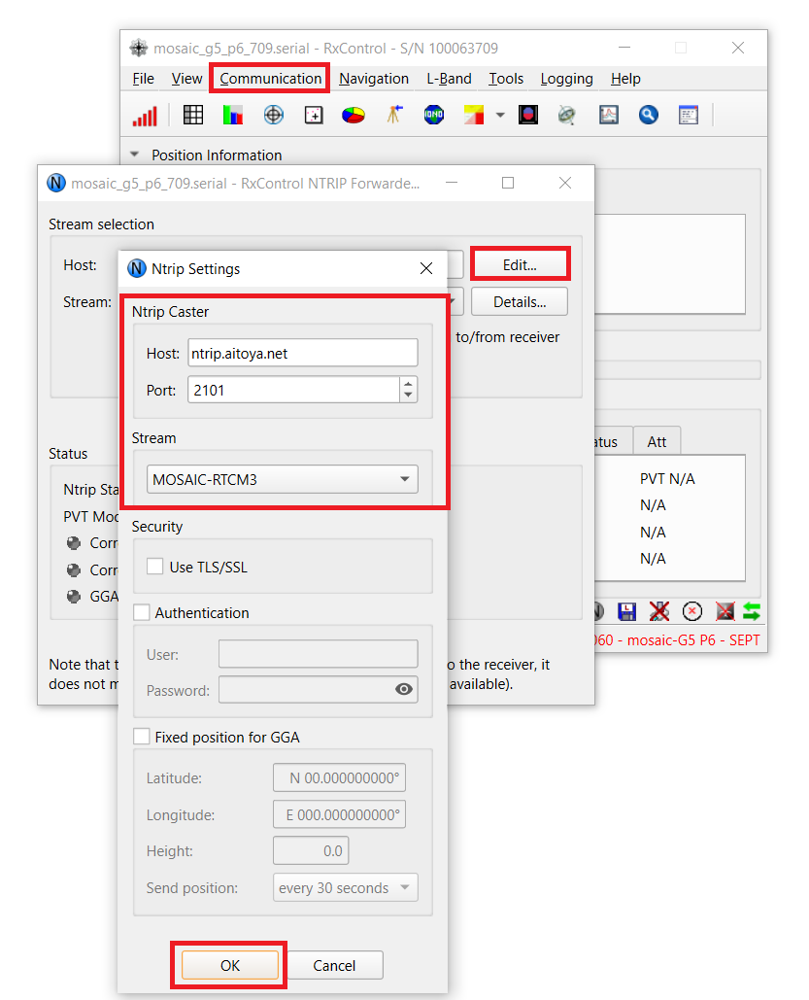

# Configuring mosaic-G5 as an RTK Rover

### Overview

This guide explains how to configure the **mosaic-G5** as an RTK rover using the built-in **NTRIP Forwarder** in Septentrio RxControl.

The NTRIP Forwarder connects to an NTRIP caster and forwards RTCM3 correction data to the receiver. With a suitable GNSS antenna setup and valid correction data, the rover can achieve an **RTK Fixed** solution.

By the end of this guide, the receiver will be connected to an NTRIP correction source, and its positioning status will be checked in RxControl.

---

### Setup Requirements
Before starting, prepare the following:

- iChidori-Crest connected to PC using USB Type-C cable.
- RxControl installed, with a connection to the mosaic-G5 established. See [Basic Setup](basic-setup.md) for the initial configuration.
- An active NTRIP caster account, including the server address, port, and mountpoint where required.
- Ensure that a GNSS antenna (or two, for Dual Antenna mode) connected to iChidori-Crest and placed antenna in open-sky view

!!! note "Correction Service"
    The caster address, port, mountpoint, and authentication requirements depend on the correction service being used. The settings below are an example and should be replaced if a different NTRIP service is used.

---

### Configure the NTRIP Forwarder

With the iChidori-Crest connected in RxControl, navigate to the RXControl NTRIP Forwarder:

Open **Communication → RXControl NTRIP Forwarder**. Click **Edit**:

Enter NTRIP caster details:

| Field | Value |
|---|---|
| Caster | ntrip.aitoya.net |
| Port | 2101 |
| Mountpoint | MOSAIC-RTCM3 |

Click **Connect** to begin streaming correction data to the receiver.

{ width=850"}

---

### Verify the RTK Solution

After connecting the NTRIP Forwarder, monitor the positioning status in RxControl.

The receiver may initially report a standalone solution while acquiring satellites or before correction data is applied. As valid corrections become available, the solution may progress to RTK Float and then RTK Fixed.

| Status | Description |
|---|---|
| No Fix | No GNSS solution |
| Standalone | GNSS fix, no corrections |
| DGPS | Differential correction applied |
| RTK Float | Corrections received, ambiguity not resolved |
| **RTK Fixed** | **Full RTK solution — centimeter-level accuracy** ✓ |

Wait for the receiver to reach RTK Fixed and check that the solution remains stable before proceeding with further evaluation.

{ width=850"}

---

### Summary

The mosaic-G5 has been configured as an RTK rover using the NTRIP Forwarder in RxControl. After connecting to the correction service, the receiver's positioning status can be monitored to confirm whether an RTK Fixed solution has been achieved.

This method provides a straightforward way to evaluate rover operation directly from a PC before integrating the correction stream into a larger system.

!!! tip
    The RxControl NTRIP Forwarder is convenient for initial testing. For more advanced correction-data routing or network configurations, consider the **Data Link Tools** included in RxTools.

The next guide covers receiver data logging and the analysis of recorded GNSS data.

**Next:** [Data Logging →](sd-logging.md)