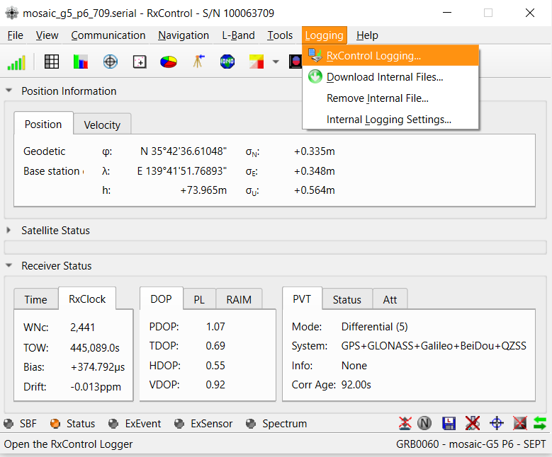
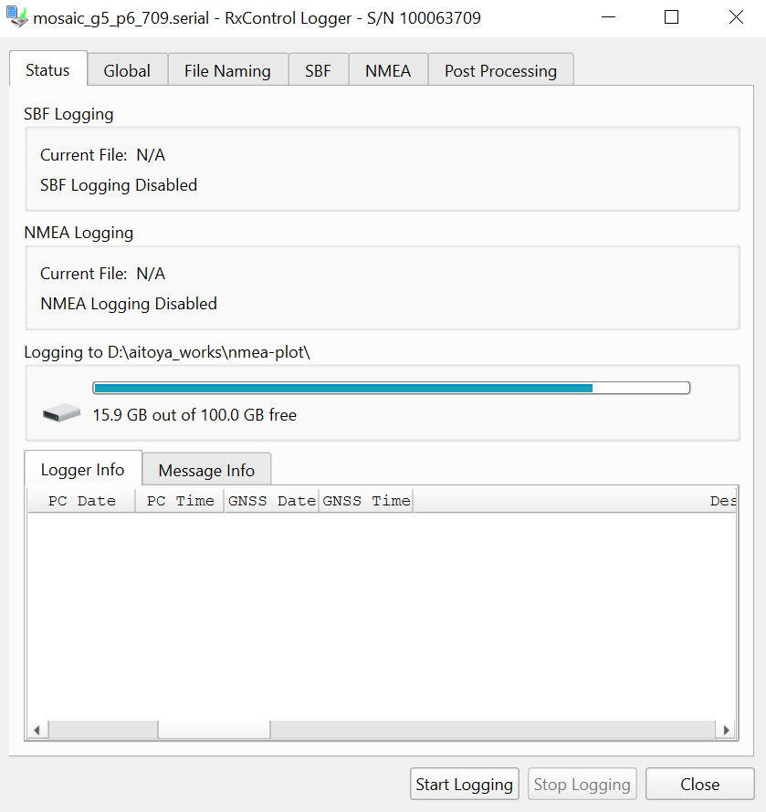
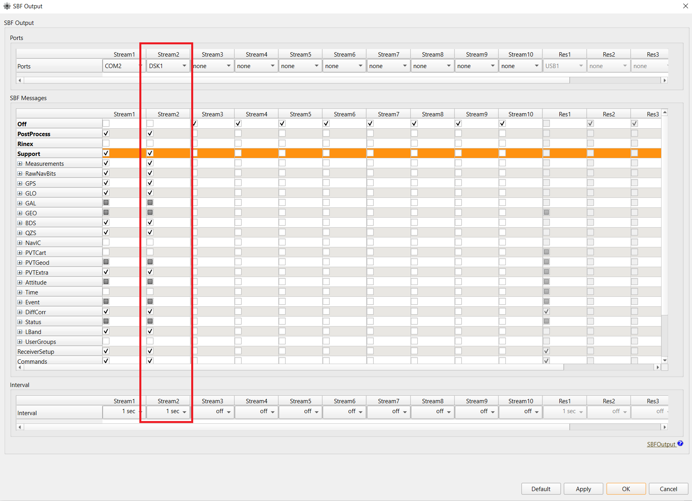
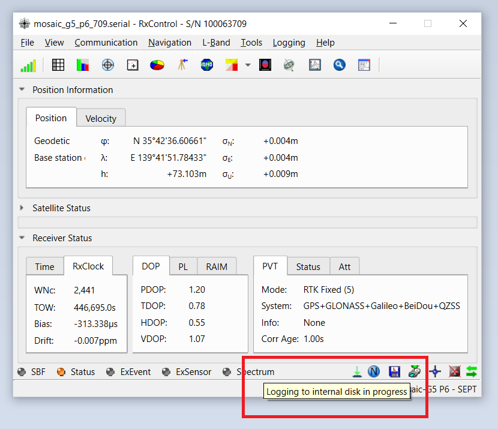
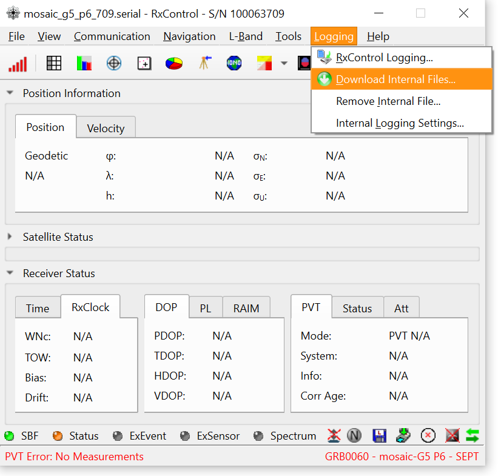

# Data Logging

### Overview

The mosaic-G5 supports several ways to record GNSS receiver data for evaluation and debugging. This guide introduces two logging methods available when using the iChidori-Crest:

- **PC logging**: Record receiver data directly to a PC using RxControl.
- **SD card logging**: Store receiver data on the onboard SD card for standalone operation without a continuously connected PC.

Both methods can be used to record SBF binary data and NMEA messages. The appropriate method depends on the test setup and how the recorded data will be retrieved and analyzed.

---

### Method 1 — Log SBF/NMEA Messages to PC via RxControl

RxControl includes a built-in logger that can record the SBF binary stream and/or NMEA ASCII stream directly to a file on your PC.

Open **Logging → RxControl Logging** to open the Logger window.

{ width="800" }

{ width="800" }

Configure the log file name and select which SBF/NMEA messages to record, then click **Start Logging**.

!!! info "Logging status"
    Closing the Logger window does **not** stop logging. Logging status is shown in the RxControl status bar:

    - Icon **active** → logging in progress
    - Icon **inactive** → logging stopped

    To stop logging, return to **Logging → RxControl Logging** and click **Stop**.

---

### Method 2 — Log SBF/NMEA Messages to Internal SD Card (DSK1)

The iChidori-Crest features a built-in SD card slot, recognized by the mosaic-G5 as **DSK1**. This enables autonomous data logging in the evaluation without a connected PC.

!!! warning "SD Card Format"
    Before inserting the SD card into the iChidori-Crest, format it as **FAT32**. The receiver must recognize the card as `DSK1` before SD card logging can be configured.
    
To configure SBF logging to the SD card, navigate to:
**Communication → Output Settings → SBF Output**

Select **DSK1** in the Ports row, choose the SBF messages to log, and set the output interval.

Click **Apply** and **OK** to save.

{ width="800" }

{ width="800" }

!!! tip "Tip: Download data from SD card"
    RxControl supports downloading logged data directly from the SD card to your PC — no need to physically remove it from the iChidori-Crest. Open **Logging → Download Internal Files** to retrieve SBF/NMEA log files from DSK1.

    { width="500" .center}

---

### Summary

In this article, we explored two data logging approaches for the mosaic-G5 on the iChidori-Crest board. Logging to PC via RxControl is convenient for quick evaluation sessions, while logging to the onboard SD card enables standalone field evaluation without a connected PC.

!!! note
    SD card logging is intended for evaluation and debugging purposes. It is not recommended for production or deployed systems.

**Next:** [Connect to a Raspberry Pi →](pi-connect.md)