## 40-Pin Header (J1)

iChidori-Crest connects to the Raspberry Pi via the standard 40-pin GPIO header.

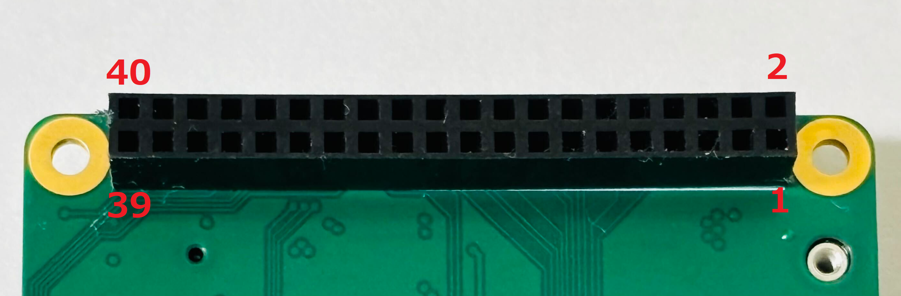{ width="790" }


Connector type: 2×20, 2.54 mm Pin socket

Mating connector: Raspberry Pi 4/5 Model B built-in 40-pin GPIO header

### 40-Pin GPIO Header Assignments

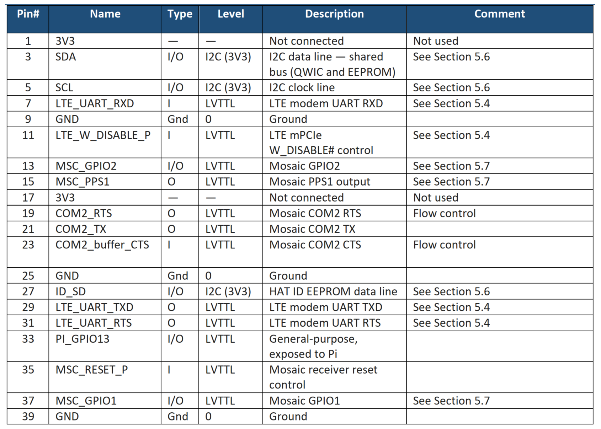{ width="800" }

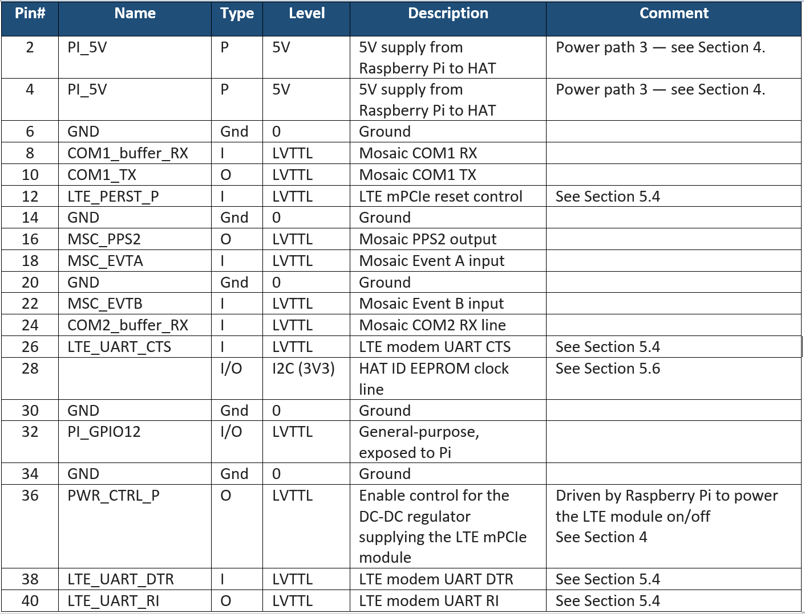{ width="790", style="margin-left: 8px;"}

### UART Interfaces Summary

| Interface | Raspberry Pi | Mosaic G5 | LTE Module |
|-----------|--------------|-----------|------------|
| G5 UART | UART0/1 (GPIO14/15) | COM1 | — |
| G5 UART | UART4 (GPIO8/9/10/11) | COM2 | — |
| LTE UART | UART3 (GPIO4/5/6/7) | — | UART |

!!! note "Serial port configuration"
    Raspberry Pi 4/5 has UART0–UART5, but most are disabled by default and require additional configuration.

    To enable UART on GPIO14/GPIO15 (TXD/RXD) for mosaic-G5 COM1:

    1. Run `sudo raspi-config`
    2. Select **Interface Options** → **Serial Port**
    3. Set **Login shell over serial** → **No**
    4. Set **Serial port hardware** → **Yes**
    5. Exit and reboot

    After reboot, verify which UART type is assigned to the primary serial port:

    ```bash
    ls -l /dev/serial0
    ```

    On Raspberry Pi 4/5, `/dev/ttyAMA*` represents PL011 UARTs and `/dev/ttyS*` represents the mini UART.

    **Use a PL011 UART (`/dev/ttyAMA*`) for communication with the mosaic-G5.**  
    PL011 UARTs have a dedicated clock and provide stable baud rates at higher speeds. The mini UART (`/dev/ttyS0`) shares the CPU clock and is not recommended for GNSS applications.

    If `serial0` points to `/dev/ttyS0`, reassign it to PL011 by adding the following line to `/boot/firmware/config.txt`:

    ```text
    dtoverlay=disable-bt
    ```

    This disables Bluetooth and frees the PL011 UART for GPIO14/GPIO15. Reboot and verify again:

    ```bash
    ls -l /dev/serial0
    ```

    Confirm that `serial0` now points to `/dev/ttyAMA0` before proceeding.

### Power Pins

| Pin | Function |
|-----|----------|
| 2, 4 | 5V from Pi |
| 6, 9, 14, 20, 25, 30, 34, 39 | GND |

## 52-Pin mPCIe Slot (J2)
iChidori-Crest provides a standard Mini PCIe (mPCIe) slot for LTE modem modules.

Connector type: 52-pin Mini PCIe edge connector, 0.8 mm pitch

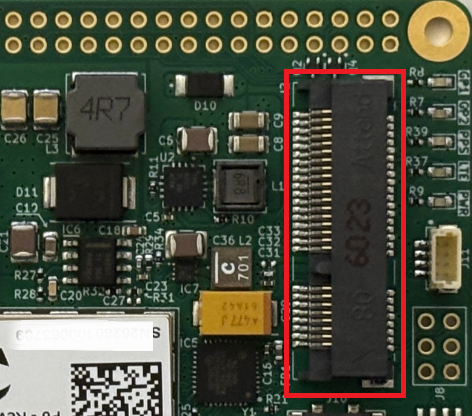{ width="700" }

### 52-Pin mPCIe Assignments

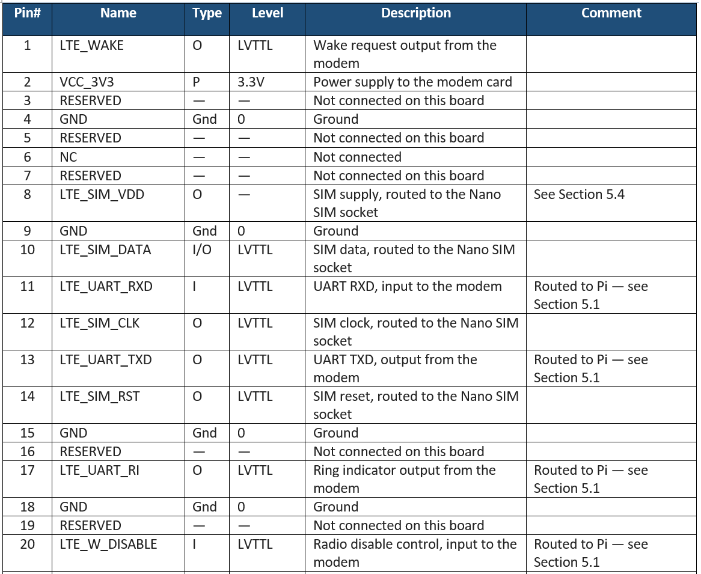{ width="800" }
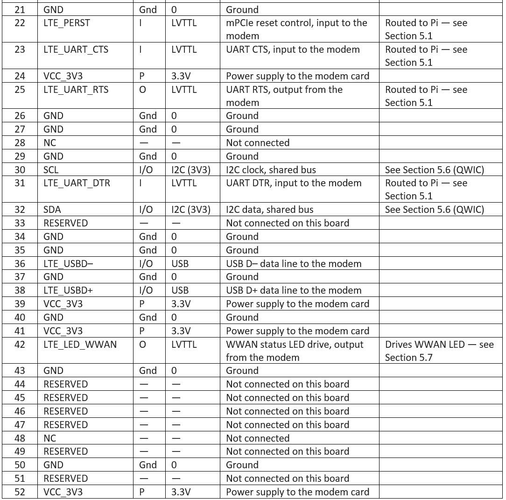{ width="800" }

## Expansion 6-Pin Header (J8)

Connector type: Conn_01×06, 2.54 mm pin header

<div style="display: flex; flex-wrap: wrap; gap: 1.5rem; align-items: flex-start;" markdown>

<div style="min-width: 140px; max-width: 200px;" markdown>

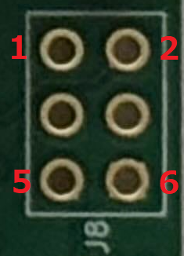{ width="140" }

</div>

<div style="flex: 1; min-width: 260px;" markdown>

| Pin | Signal | Description |
|-----|--------|-------------|
| 1 | PI_GPIO13 | Raspberry Pi GPIO13 |
| 2 | LTE_WAKE# | LTE modem wake signal (active low) |
| 3 | PI_GPIO12 | Raspberry Pi GPIO12 |
| 4 | +3V3 | 3.3V power |
| 5 | WP | EEPROM Write protect |
| 6 | GND | Ground |

</div>

</div>

## USB device Interface (J5)

Connector type: USB Type-C, USB 2.0

<div style="display: flex; gap: 2rem; align-items: flex-start;" markdown>

<div markdown>

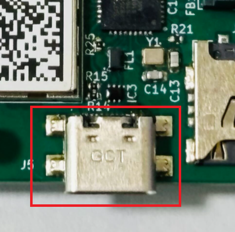{ width="900" }

</div>

<div markdown>

The USB-C connector serves as the **primary power supply and data interface**.

An internal 2-port USB hub routes the single connector to two independent device interfaces:

| Port | Connected Device |
|------|-----------------|
| 1 | Mosaic G5 USB device interface |
| 2 | LTE mPCIe USB device interface |


</div>

</div>

## GNSS Antenna Connectors

iChidori-Crest provides two MMCX antenna ports for the mosaic-G5 receiver.

<div style="margin-left: 12px;" markdown> 
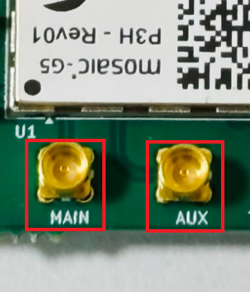{ width="400" }
</div>

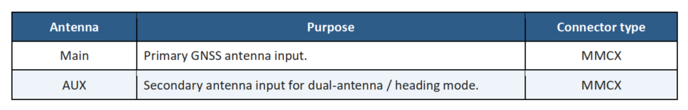{ width="700" }

!!! note "Antenna supply voltage"
    Both ports supply **V_ANT = 3.3 V** DC to power active GNSS antennas.

### Antenna Mode Setting

iChidori-Crest is offered in variants that differ in antenna capability:

| Variant | Antenna Mode |
|---------|-------------|
| P1, P3 | Single-antenna only |
| P3H, P6 | Single-antenna or dual-antenna (heading) |

Use the following commands to check or configure the antenna mode (needs to be done only once):

- `getFrontendMode` — query the current antenna mode
- `setFrontendMode, SingleAnt` — configure single-antenna mode at the next reboot
- `setFrontendMode, DualAnt` — configure dual-antenna (heading) mode at the next reboot
- `exeCopyConfigFile, Current, Boot` — save the configuration to the boot file
- `exeResetReceiver, Hard, none` — reboot to apply

Connect an active antenna to ANT_1 (MAIN). The ANT_1 input is DC-biased and ESD-protected; an active antenna can be connected directly without additional components. Leave ANT_2 (AUX) open when operating in single-antenna mode.

## SD Logging (J4)
A physical SD card slot is provided for direct on-board logging by the mosaic-G5 receiver.

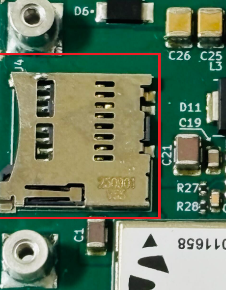{ width="400" }

!!! note
    This SD logging capability is intended for evaluation and debugging purposes only; it is not recommended for use in production/deployed systems.

## SIM Card (J10)

The board provides a Nano SIM socket for the LTE module.

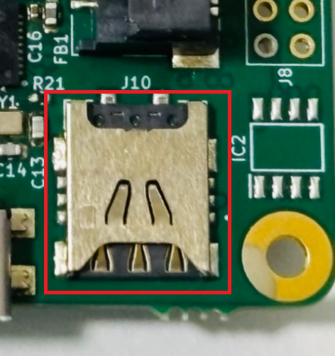{ width="400" }

!!! note "SIM slot on the LTE card"
    If the installed LTE card has its own SIM slot, the SIM can be inserted directly into that slot instead of the Nano SIM socket on the HAT. This allows SIM sizes other than Nano (for example Micro or Mini, depending on the card) to be used. The supported SIM types therefore depend on the LTE card in use.

## QWIC Connector (J11)
A QWIC connector is provided for expansion I2C communication.

<div style="display: flex; gap: 2rem; align-items: flex-start;" markdown>

<div markdown>

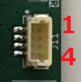{ width="220" }

</div>

<div markdown>

| Pin | Signal |
|-----|--------|
| 1 | GND |
| 2 | 3.3V |
| 3 | SDA |
| 4 | SCL |

</div>

</div>

<div markdown style="display: flex; justify-content: space-between;">

**Back:** [← Overview](overview.md)

**Next:** [Specifications →](specifications.md)

</div>

---

## Quick Navigation

<div class="grid cards" markdown>

- :material-home: **[Home](../index.md)**  
  Welcome and project overview

- :material-play-circle: **[Getting Started](../getting-started/basic-setup.md)**  
  Step-by-step setup from unboxing to first fix

- :material-antenna: **[Application Examples](../application-examples/clas-madoca.md)**  
  RTK, data logger, RxTool experiments

- :material-wrench: **[Troubleshooting](../troubleshooting.md)**  
  Common issues and fixes

</div>
