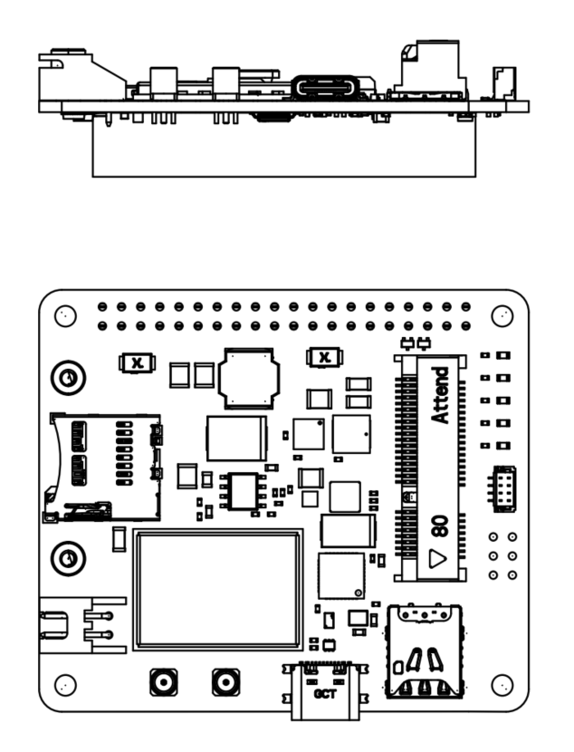
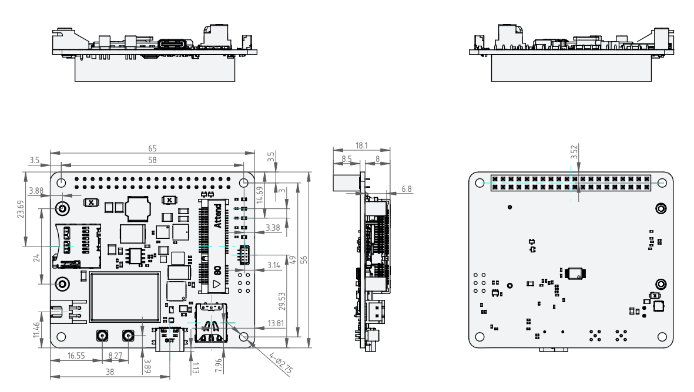
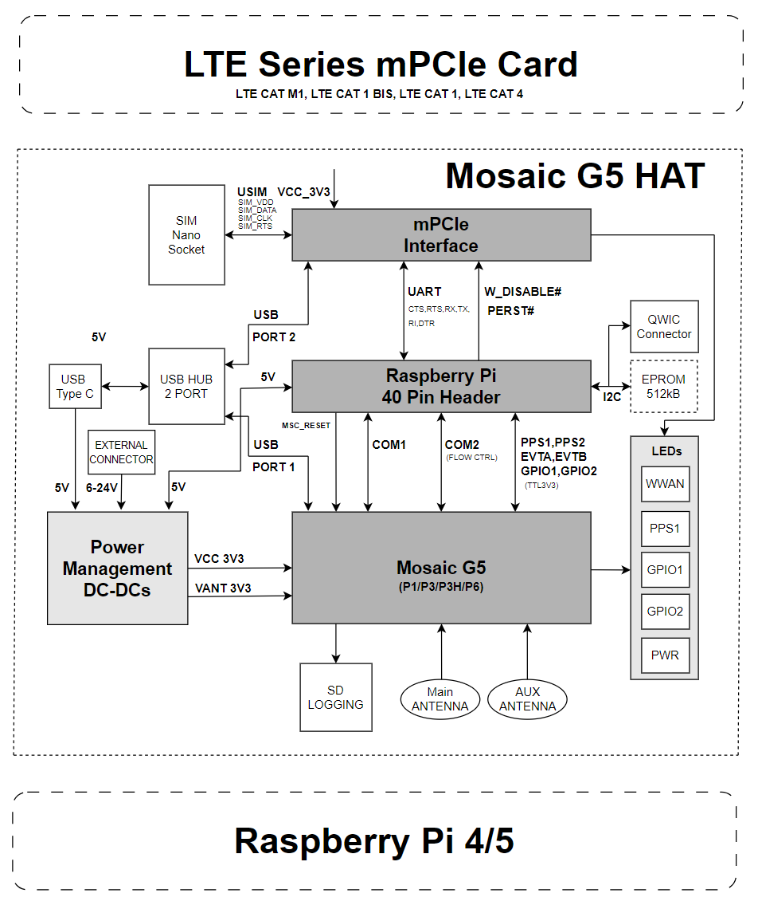

# Hardware Overview

<iframe src="../../viewer1.html" width="100%" height="460" frameborder="0"></iframe>

## Board Layout

{ width="700" .center}

{ width="800" .center}

## Block Diagram

<!-- TODO: insert block diagram image -->

## LTE Modems Tested

The iChidori-Crest has been tested with the following LTE modems:

| LTE Modem    | Category          | Interface  |
|---------------|-------------------|------------|
| Quectel EC21-J | LTE Cat 1        | USB + UART |
| Quectel BG96   | LTE Cat M1 / NB-IoT | USB + UART |

Other LTE modem should be work, provided they use a compatible mPCIe form factor and interface configuration.

!!! note
    The mPCIe LTE I²C interface is not connected in the current board revision. Use USB or UART for LTE communication.

**Next:** [Interfaces →](interfaces.md)

---

## Quick Navigation

- :material-home: **[Home](../index.md)**  
  Welcome and project overview

- :material-play-circle: **[Getting Started](../getting-started/basic-setup.md)**  
  Step-by-step setup from unboxing to first fix

- :material-antenna: **[Application Examples](../application-examples/clas-madoca.md)**  
  RTK, data logger, RxTool experiments

- :material-wrench: **[Troubleshooting](../troubleshooting.md)**  
  Common issues and fixes

