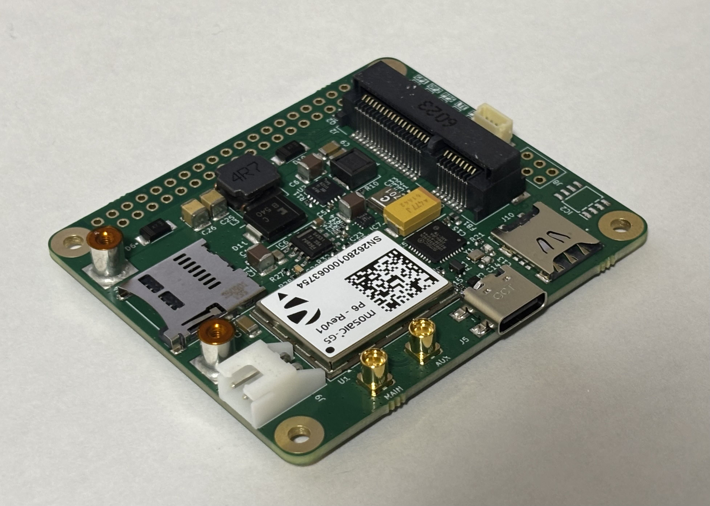
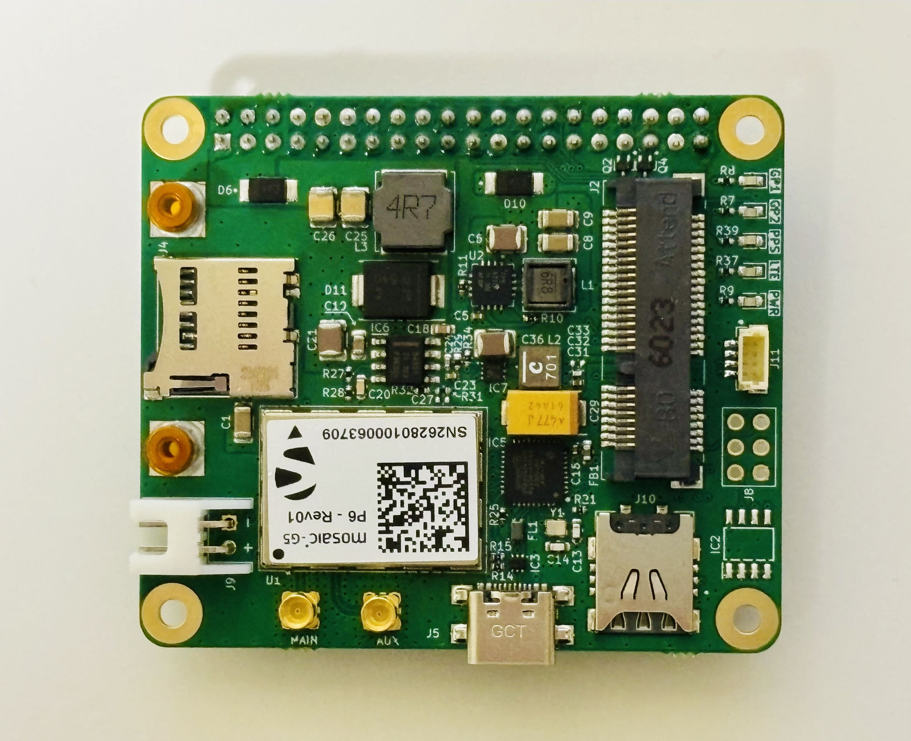
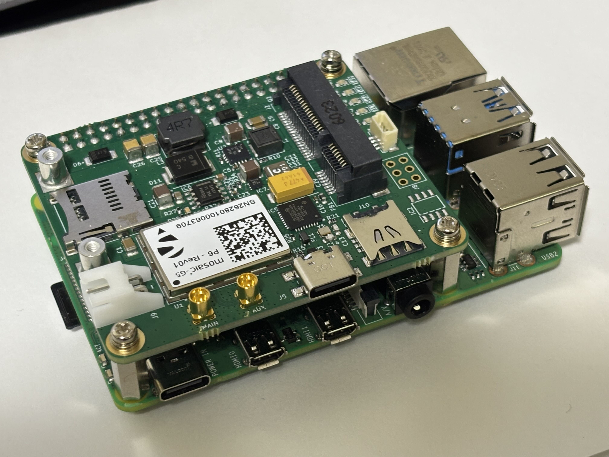
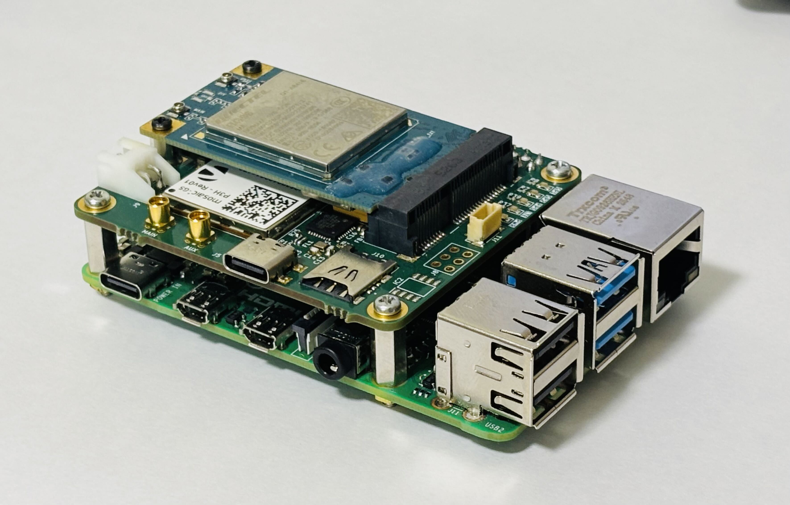

# iChidori-Crest

**iChidori-Crest** is a compact Raspberry Pi HAT designed for high-precision GNSS positioning and embedded applications. It integrates a Septentrio mosaic-G5 GNSS receiver module with an mPCIe interface for an LTE modem, onboard power management, SD card logging, and additional connectivity and expansion interfaces.

Designed for Raspberry Pi 4/5, iChidori-Crest provides a flexible hardware platform for RTK positioning, remote monitoring, and GNSS-based applications. It is available in variants — P1, P3, P3H, and P6 — sharing the same board hardware while offering different GNSS receiver capabilities.

{ width="820", style="margin-left: 0px;"}

## Powered by the Next-Generation Septentrio mosaic-G5

At the heart of iChidori-Crest is the [Septentrio mosaic-G5](https://www.septentrio.com/en/products/gnss-receivers/gnss-receiver-modules/mosaic-G5-P6), a new generation of ultra-compact, high-performance GNSS receiver modules. Combining multi-constellation, multi-frequency satellite tracking with centimeter-level RTK positioning, mosaic-G5 brings advanced positioning capabilities to space- and power-constrained systems.

Compared with the mosaic-X5, mosaic-G5 offers a **60% smaller module footprint and 40% lower power consumption**, while maintaining high-precision positioning performance. Depending on the receiver variant, the series supports tracking of up to four frequencies, output rates of up to 100 Hz, and [AIM+ Premium](https://www.septentrio.com/en/learn-more/advanced-positioning-technology/gps-gnss-interference#paragraph-id-21060), advanced [GNSS+ algorithms](https://www.septentrio.com/en/learn-more/Advanced-positioning-technology/gnss-technology) for enhanced resilience against interference and spoofing.

These capabilities make mosaic-G5 well suited for compact RTK systems, robotics, autonomous platforms, and other applications where positioning performance, reliability, size, and power efficiency are critical.

---

## What's on the Board

| Component | Description |
|-----------|-------------|
| **GNSS** | Septentrio mosaic-G5 — multi-constellation, multi-frequency GNSS receiver  |
| **Antenna** | Main and auxiliary antenna connections |
| **LTE** | PCI Express Mini Card slot for an LTE modem, with an onboard nano-SIM socket |
| **Host** | Raspberry Pi 4/5 via the 40-pin GPIO Header |
| **Power** | USB-C 5V, External VIN 6–24V, or Pi 5V rail |

## Board Variants

=== "HAT Only"
    Use iChidori-Crest board standalone
    { width="850" }
=== "HAT with Raspberry Pi"
    Mount on a Raspberry Pi 4/5 for a self-contained GNSS/Network system.
    { width="850" }
=== "HAT + Pi + LTE"
    Full remote deployment — Pi connects to internet via LTE, streams GNSS data.
    { width="800"}
---

## Quick Navigation

- :material-hammer-wrench: **[Hardware Reference](hardware-reference/overview.md)**  
  Board layout, interfaces, specifications

- :material-play-circle: **[Getting Started](getting-started/basic-setup.md)**  
  Step-by-step setup from unboxing to first fix

- :material-antenna: **[Application Examples](application-examples/clas-madoca.md)**  
  RTK, data logger, RxTool Experiments

- :material-wrench: **[Troubleshooting](troubleshooting.md)**  
  Common issues and fixes

